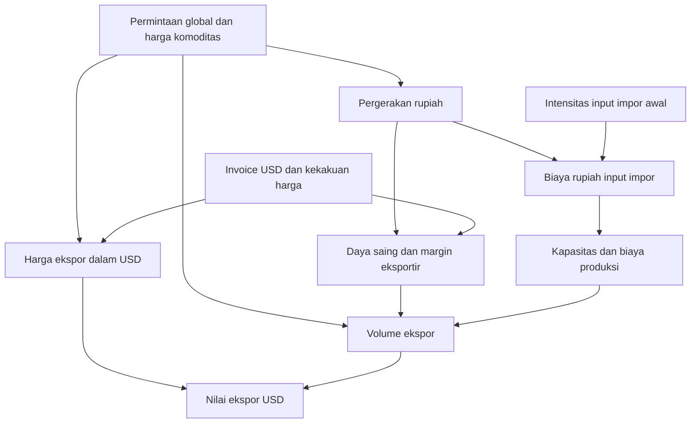

# Depresiasi Rupiah dan Kinerja Ekspor Indonesia: Harga Komoditas, Input Impor, dan Transmisi Nilai Tukar

> **Pembaruan tujuan, 17 November 2026:** setelah PDF acuan diberikan, tujuan diperjelas menjadi replikasi metode Bahmani-Oskooee & Fariditavana (online 2015/edisi 2016), dengan trade balance sebagai outcome utama. Untuk tujuan terbaru ini, ARDL/NARDL menjadi metode utama; rekomendasi PPML di dokumen ini berlaku untuk alternatif desain ekspor level yang dibahas sebelumnya. Rincian paper yang benar, data yang masih kurang, dan ekstensi HS/BEC ada di [audit kebutuhan data replikasi](kebutuhan_data_replikasi_nardl_hs_bec.md).

Tanggal penyusunan: **17 November 2026**. Penelusuran sumber: 16–17 November 2026.  
Lokasi proyek aktif: `F:/Trade-Balance`.  
Status: literature review kritis dan usulan desain penelitian; **belum merupakan hasil estimasi**.

Dokumen ini melanjutkan workbook pengguna `Literature_Review_-_Rupiah_Depresiasi_Apresiasi_Trade_Balance.xlsx` (23 studi pada Sheet1 dan satu sheet Sintesis Tematik), [catatan data Tio](catatan_data_panel.md), serta membaca [review metode Haikal](../../Haikal/notes/litrev_metode_ardl.md) sebagai konteks. Klaim hasil di folder Haikal tidak direplikasi di sini. Workbook diperlakukan sebagai bahan literatur, bukan instruksi kerja.

## 1. Rekomendasi utama

**Gunakan kerangka ekspor yang menggabungkan permintaan luar negeri, penawaran dengan input impor, dan penetapan harga dalam dolar; uji heterogenitas respons kurs menurut eksposur komoditas dan intensitas input impor.** J-curve/Marshall–Lerner menjadi konteks dan analisis tambahan jika penelitian tetap ingin membahas neraca perdagangan.

Pertanyaan yang disarankan:

> Seberapa besar depresiasi rupiah meningkatkan ekspor Indonesia, dan apakah manfaat tersebut melemah pada produk yang terpapar harga komoditas global serta industri dengan kandungan input impor tinggi?

Rumusan ini membuat gagasan awal dapat ditolak oleh data. Penelitian tidak diarahkan untuk memperoleh koefisien negatif. Ada empat hasil yang sama-sama sah: manfaat positif; manfaat positif tetapi lebih kecil pada sektor tertentu; efek yang cukup presisi mendekati nol; atau efek negatif. Interval kepercayaan yang lebar berarti bukti belum cukup.

**Pilihan empiris utama:** panel produk/industri × negara tujuan × bulan, dengan model PPML untuk nilai ekspor dan interaksi kurs–karakteristik industri. Lengkapi dengan data volume/indeks volume, harga komoditas spesifik, serta intensitas input impor dari I-O/TiVA. Tambahkan local projections pada agregasi sektor untuk dinamika bila data dan ukuran sampel mendukung. ARDL/NARDL dapat menjadi pembanding parsimonis, bukan satu-satunya bukti mekanisme.

Dengan data saat ini, judul yang aman membahas **nilai ekspor**. Klaim tentang volume, produktivitas, atau kandungan nilai tambah memerlukan data tambahan.

## 2. Cakupan dan cara menilai literatur

Review ini merupakan **review terarah dengan penelusuran sumber primer**, bukan systematic review PRISMA atau pencarian menyeluruh Scopus/WoS. Penelusuran mencakup teori, bukti Indonesia, bukti perusahaan internasional, bukti yang mendukung manfaat depresiasi, metode, dan dokumentasi data.

Kelompok pencarian:

- exchange rate depreciation, export performance, Indonesia;
- imported inputs, export elasticity, global value chains, exchange rate pass-through;
- commodity prices, commodity currencies, trade balance;
- dominant currency pricing, dollar invoicing;
- ARDL/NARDL, local projections, PPML, input-output, TiVA.

Prioritas sumber: jurnal/penerbit dan repositori penulis/universitas; BI, IMF, World Bank, OECD, BPS dan UNSD. Ringkasan dibatasi pada bagian yang berhasil dibaca. Tidak ada angka sampel atau koefisien yang ditebak untuk melengkapi abstrak.

Kode bukti:

| Kode | Arti |
|---|---|
| T | Teks/bagian naskah utama berhasil dibaca; bukan jaminan seluruh lampiran direplikasi |
| A | Abstrak dan metadata penerbit atau repositori institusi berhasil diperiksa |
| D | Dokumentasi atau statistik resmi; mendukung definisi/fakta, bukan identifikasi sebab-akibat |
| U | Ada di workbook awal, tetapi belum terverifikasi ulang secara memadai dalam sesi ini |

Tahun online-first dibedakan dari tahun edisi jurnal. Working paper dan artikel jurnal yang berasal dari penelitian sama tidak dihitung sebagai dua bukti independen.

## 3. Perbaikan atas dua premis awal

### 3.1 Ekspor komoditas: penting, tetapi “didominasi” perlu definisi

Ekspor berbasis sumber daya tidak identik dengan sektor pertambangan. Minyak sawit olahan dan logam hasil pengolahan bisa masuk industri pengolahan meskipun terpapar harga komoditas. Karena itu, membagi pertanian/pertambangan versus manufaktur saja tidak cukup.

Sebagai konteks resmi, Kementerian Keuangan melaporkan pangsa HS27, HS15, dan HS72 masing-masing 15,94%, 10,78%, dan 10,37% dari ekspor nonmigas 2024. Ketiganya berjumlah **37,09%**, yang menunjukkan konsentrasi penting, tetapi bukan dengan sendirinya bukti bahwa seluruh ekspor Indonesia mayoritas komoditas. HS72 pun memuat produk dengan tingkat pengolahan berbeda. [Sumber resmi Kemenkeu](https://fiskal.kemenkeu.go.id/publikasi/siaran-pers-detil/603).

Operasionalisasi yang disarankan: buat daftar HS4 komoditas dan produk berbasis sumber daya dengan alasan pemetaan; laporkan pangsa menurut tahun dan tujuan, lalu uji sensitivitas terhadap klasifikasi sempit dan luas. Jangan menyamakan seluruh HS15 atau HS72 dengan satu tingkat homogenitas harga.

**Harga global dominan tidak berarti kurs pasti tidak berpengaruh.** Produsen komoditas tetap bisa meningkatkan penawaran karena penerimaan rupiah naik relatif terhadap biaya domestik, meskipun harga USD tidak berubah. Pada beberapa komoditas Indonesia juga cukup besar dalam pasar dunia; asumsi price taker sempurna perlu kehati-hatian.

### 3.2 Input impor: komplementer dengan ekspor, bukan otomatis buruk

Angka pangsa bahan baku/penolong dalam total impor menjelaskan struktur impor nasional. Angka itu bukan kandungan impor dalam ekspor. Impor bisa dipakai untuk produksi yang dijual domestik, sementara input impor dalam ekspor juga bisa masuk secara tidak langsung melalui pemasok domestik.

Bedakan:

| Ukuran | Definisi | Kegunaan dan batas |
|---|---|---|
| Pangsa impor bahan baku | Impor bahan baku / total impor | Deskripsi impor; tidak mengukur ketergantungan eksportir |
| Intensitas input impor langsung | Input antara impor / total input antara industri | Mengukur eksposur biaya langsung industri |
| Foreign value-added share | Nilai tambah asing yang terkandung dalam ekspor / ekspor bruto | Mengukur backward GVC, termasuk jaringan produksi; tidak identik dengan pangsa biaya input |
| Impor/ekspor HS yang sama | Nilai impor HS-k / nilai ekspor HS-k | Bukan ukuran kandungan input; bahan baku dapat berasal dari HS lain |

Impor input bisa meningkatkan kualitas, variasi, dan produktivitas. Hipotesis yang lebih tepat adalah: **kenaikan biaya atau hambatan akses input impor dapat mengurangi manfaat depresiasi bagi ekspor**. Ini berbeda dari kesimpulan “impor input harus dikurangi”.

## 4. Sintesis teori: mengapa tanda efek tidak harus seragam?

### 4.1 Kanal daya saing tradisional

Depresiasi riil dapat menurunkan harga relatif ekspor bagi pembeli asing bila diteruskan ke harga, menaikkan permintaan. Akan tetapi, respons juga membutuhkan kapasitas produksi, permintaan luar negeri, serta elastisitas substitusi. Bukti undervaluation–growth Rodrik merupakan argumen pembanding yang penting, tetapi outcome pertumbuhan dan undervaluation persisten berbeda dari respons ekspor atas depresiasi bulanan. [Rodrik, 2008](https://www.brookings.edu/articles/the-real-exchange-rate-and-economic-growth/).

Marshall–Lerner standar, dengan asumsi pembentuknya termasuk kondisi awal perdagangan dan pass-through, membahas **neraca perdagangan**, bukan syarat universal agar ekspor naik. Jangan mengklaim menguji kondisi tersebut hanya dari regresi ekspor terhadap kurs.

### 4.2 Kanal komoditas dan endogenitas

Nilai ekspor USD secara identitas adalah harga USD dikalikan kuantitas. Penurunan harga global dapat menurunkan nilai ekspor sekaligus melemahkan rupiah. Korelasi depresiasi–ekspor negatif kemudian bisa berasal dari guncangan yang sama, bukan efek depresiasi yang negatif.

Literatur commodity currencies menunjukkan keterkaitan fundamental harga komoditas dan kurs, tetapi tidak menjadi instrumen siap pakai bagi Indonesia. Harga komoditas justru mempunyai jalur langsung ke ekspor. [Chen, Rogoff & Rossi, 2010](https://academic.oup.com/qje/article-abstract/125/3/1145/1903653).

### 4.3 Kanal input impor dan markup

Model dengan input impor dan markup memberikan alasan mengapa keuntungan daya saing lebih kecil pada eksportir yang juga importir. Temuan pass-through harga tidak otomatis sama dengan temuan volume ekspor negatif. [Amiti, Itskhoki & Konings, 2014](https://www.aeaweb.org/articles?id=10.1257/aer.104.7.1942).

Ilustrasi akuntansi berikut merupakan penyederhanaan dokumen ini, bukan estimasi Indonesia:

```text
e = rupiah per USD; m = pangsa input impor dalam biaya
C_IDR ≈ C_dom^(1-m) × (e × P_input_USD)^m
C_USD = C_IDR / e

Dengan harga input USD, biaya domestik, dan teknologi tetap:
d ln(C_USD) / d ln(e) ≈ -(1-m)
```

Jika m = 0,4, depresiasi 10% kira-kira menurunkan biaya USD 6%, bukan 10%. Contoh ini menunjukkan **peredaman manfaat**, belum menunjukkan kerugian bersih. Efek negatif membutuhkan kanal tambahan yang cukup kuat, misalnya kebutuhan modal kerja, kelangkaan input, utang valas, atau kualitas input yang tidak mudah diganti.

### 4.4 Penetapan harga dolar dan natural hedge

Harga ekspor yang kaku dalam USD dapat membuat depresiasi rupiah tidak segera menurunkan harga USD. Di sisi lain, penerimaan USD membantu membiayai input USD sehingga sebagian eksposur terimbangi. Efek bersih bergantung pada mata uang invoice, waktu pembayaran, markup dan akses pembiayaan. Dominant currency paradigm memberi alasan menguji kurs terhadap USD serta kurs riil; tidak membuktikan bahwa seluruh ekspor Indonesia memakai invoice dolar. [Gopinath et al., 2020](https://www.aeaweb.org/articles?id=10.1257/aer.20171201).

### 4.5 Dinamika dan hasil yang berbeda

Ekspor, impor, dan neraca perdagangan harus dianalisis terpisah. Neraca perdagangan bisa membaik karena impor merosot meskipun ekspor stagnan; penerimaan rupiah bisa naik tanpa kenaikan ekspor USD atau volume. Teori contractionary devaluation mengingatkan bahwa efek output juga dapat berbeda dari efek perdagangan. [Larraín & Sachs, 1986](https://www.nber.org/papers/w2078).

## 5. Matriks literatur inti

Ringkasan berikut menyatukan temuan, batas inferensi, dan konsekuensi desain. Angka rinci yang belum diverifikasi tidak dibawa dari workbook.

| Studi dan akses | Data/metode yang terverifikasi | Temuan yang relevan | Batas dan implikasi |
|---|---|---|---|
| [Amiti & Konings (2007), AER 97(5):1611–1638](https://pubs.aeaweb.org/doi/10.1257/aer.97.5.1611), A | Sensus manufaktur Indonesia 1991–2001; informasi input impor tingkat pabrik | Penurunan tarif input meningkatkan produktivitas, terutama pada importir input | Guncangan tarif, bukan depresiasi. Menguatkan pentingnya akses input; jangan menganggap impor selalu membebani ekspor |
| [Pane & Patunru (2023; online 2022), Review of World Economics 159:629–672](https://link.springer.com/article/10.1007/s10290-022-00476-z), T | Data perusahaan dan bea cukai Indonesia 2008–2012; IV untuk input impor | Akses input impor meningkatkan produktivitas dan ekspor; variasi input penting | Bukan estimasi efek depresiasi agregat; validitas IV tetap perlu dievaluasi. Rujukan Indonesia paling langsung untuk komplementaritas impor–ekspor |
| [Amiti, Itskhoki & Konings (2014), AER 104(7):1942–1978](https://www.aeaweb.org/articles?id=10.1257/aer.104.7.1942), A | Model markup dan input impor; data perusahaan-produk Belgia | Import intensity dan market share tinggi terkait pass-through harga ekspor yang lebih rendah | Bukti lintas konteks; mendasari interaksi depresiasi × input impor, bukan asumsi koefisien ekspor pasti negatif |
| [Ahmed, Appendino & Ruta (2015), IMF WP/15/252](https://www.imf.org/external/pubs/ft/wp/2015/wp15252.pdf), T; versi jurnal 2017 | Panel perdagangan manufaktur dan GVC | Backward integration dapat meredam elastisitas ekspor terhadap REER | Ukuran GVC makro tidak identik intensitas biaya perusahaan. IMF WP melaporkan rata-rata peredaman 22%; bukan elastisitas khusus Indonesia |
| [Gopinath et al. (2020), AER 110(3):677–719](https://www.aeaweb.org/articles?id=10.1257/aer.20171201), A | Teori dan indeks harga/volume bilateral >2.500 pasangan negara; data perusahaan Kolombia | Kurs terhadap dolar penting dalam harga dan volume perdagangan | Tidak langsung mengukur invoice Indonesia. Tambahkan kanal dolar tanpa menganggap kurs bilateral tidak pernah relevan |
| [Patnam/IMF (2019), Indonesia Selected Issues, bab pp.4–15](https://www.imf.org/-/media/files/publications/cr/2019/1idnea2019002.pdf), T | Harga dan volume sektoral bulanan; pass-through dan perbedaan integrasi GVC | Efek berbeda antarsektor dan sumber guncangan; depresiasi 10% dikaitkan dengan kenaikan net exports barang hingga 1,6% PDB | Bukti pembanding yang mendukung manfaat depresiasi, bukan bantahan terhadap heterogenitas. Outcome net exports berbeda dari ekspor |
| [Bahmani-Oskooee & Harvey (2009), JEI 24(4):765–777](https://www.e-jei.org/upload/DQ3002262N107162.pdf), A | Perdagangan bilateral Indonesia dengan 13 mitra; dinamika jangka pendek/panjang | J-curve ditemukan untuk lima mitra | Ketiadaan J-curve tidak membuktikan efek ekspor negatif. Mendukung disagregasi mitra |
| [Bahmani-Oskooee & Harvey (2015), International Trade Journal 29(2):103–114](https://www.tandfonline.com/doi/abs/10.1080/08853908.2015.1005779), A terbatas | Perdagangan AS–Indonesia per industri | Fokus pada heterogenitas industri yang tersembunyi dalam agregat | Jangan membawa angka industri/periode dari workbook tanpa mengecek tabel lengkap |
| [Bahmani-Oskooee & Harvey (2019), NZ Economic Papers 53(1):63–76](https://pure.psu.edu/en/publications/the-j-curve-and-bilateral-trade-balances-of-indonesia-with-its-ma/), A | Model bilateral asimetris; kontrol krisis 1997 dan 2008 | Asimetri jangka pendek meluas; asimetri jangka panjang pada lima model bilateral | Asimetri tidak mengidentifikasi penyebab komoditas atau input impor |
| [Rifami & Heriqbaldi (2023), Iranian Economic Review 27(4):1382–1415](https://scholar.unair.ac.id/en/publications/exchange-rate-and-indonesia-china-bilateral-industry-trade-flows-/), A | 50 industri Indonesia–Tiongkok, 1993Q1–2019Q4; ARDL/NARDL | Respons kurs berbeda antarsektor; model nonlinear menemukan lebih banyak respons signifikan | Signifikansi tidak menyatakan arah atau kausalitas; satu mitra tidak mewakili seluruh ekspor |
| [Mashilal & Pambudi (2024), Signifikan 13(1):143–156](https://journal.uinjkt.ac.id/signifikan/article/view/40972/14718), A | Studi depresiasi–neraca perdagangan yang memasukkan harga komoditas | Relevan untuk menggabungkan kurs dan siklus komoditas dalam pembahasan | Klaim workbook “hanya saat harga komoditas naik” perlu verifikasi spesifikasi interaksi/regime; VECM linear saja belum menguji syarat itu |
| [Aswicahyono, Narjoko & Hill (2008), ANU WP 2008/18](https://crawford.anu.edu.au/sites/default/files/2025-02/2008-18.pdf), T terbatas | Kajian industrialisasi Indonesia pascakrisis | Menempatkan respons manufaktur dalam konteks struktural dan pemulihan krisis | Bukti historis/kontekstual; bukan identifikasi kausal depresiasi terhadap ekspor |
| [Calì, Caicedo Graciano, Ghose, Montfaucon & Ruta (2026), JDE 179:103561](https://www.sciencedirect.com/science/article/pii/S0304387825001129), A dan bagian artikel | Perusahaan Indonesia di pasar Jepang, persaingan dengan Tiongkok; NTM pada input | Eksportir yang menghadapi NTM lebih sulit memanfaatkan input Tiongkok yang lebih murah ketika yuan melemah | Guncangan yuan, bukan rupiah. Menunjukkan kanal input dan kompetisi pihak ketiga dapat bekerja berlawanan |
| [Auboin & Ruta (2013), World Trade Review 12(3):577–605](https://www.cambridge.org/core/journals/world-trade-review/article/abs/relationship-between-exchange-rates-and-international-trade-a-literature-review/486C5AC908CDBE851869FE8540A3A97A), A | Survei volatilitas dan misalignment kurs | Respons perdagangan bergantung pada pricing, hedging dan jaringan produksi | Volatilitas, undervaluation dan depresiasi adalah konsep berbeda; jangan dijadikan satu treatment |
| [Bahmani, Harvey & Hegerty (2013), Journal of Economic Studies 40(3):411–443](https://pure.psu.edu/en/publications/empirical-tests-of-the-marshall-lerner-condition-a-literature-rev/), A | Survei, uji ulang elastisitas, serta estimasi 29 negara | Dukungan statistik Marshall–Lerner lebih lemah dibanding kesan dari point estimates | Harus menguji ketidakpastian dan batas hipotesis; bukan cukup menjumlahkan koefisien |
| [IMF WEO (2015), bab 3](https://www.imf.org/external/pubs/ft/weo/2015/02/pdf/c3.pdf), T terbatas | Bukti lintas negara tentang kurs, harga dan volume | Menemukan hubungan perdagangan–kurs yang tetap bermakna; GVC tidak menghapus seluruh respons | Wajib dipakai sebagai bukti penyeimbang terhadap narasi disconnect universal |
| [Rodrik (2008), BPEA](https://www.brookings.edu/articles/the-real-exchange-rate-and-economic-growth/), A | Hubungan kurs riil, tradables dan pertumbuhan lintas negara | Undervaluation dapat mendukung sektor tradables dan pertumbuhan | Bukan bukti bahwa setiap depresiasi jangka pendek meningkatkan ekspor |
| [Gruss & Kebhaj (2019), IMF WP/19/21](https://www.imf.org/-/media/files/publications/wp/2019/wp1921.pdf), T terbatas | Indeks harga komoditas spesifik negara; bobot perdagangan | Memisahkan shock harga global sesuai struktur ekspor dan impor | Berguna untuk desain indeks berbobot tetap; coverage pembaruan perlu dicek sebelum dipakai |

### Sintesis lintas studi

Terdapat dukungan kuat bagi **efek bersyarat**, tetapi tidak cukup dasar untuk menetapkan efek depresiasi Indonesia selalu negatif. Bukti perusahaan memberi mekanisme lebih jelas; studi J-curve memberi pola dinamika neraca perdagangan. Menggabungkan keduanya secara kritis lebih kuat daripada memperbanyak studi agregat dengan regresor serupa.

Keterbatasan umum: pengukuran nilai bukan volume; input impor tidak diamati pada eksportir yang sama; kurs dan perdagangan ditentukan bersama; komoditas sekaligus memengaruhi penerimaan ekspor dan nilai tukar; serta hasil sangat sensitif pada tingkat agregasi.

## 6. Audit terhadap 23 studi dalam workbook awal

Tabel ini mempertahankan jejak seluruh studi awal tanpa mengklaim semuanya telah dibaca ulang penuh.

| No. Excel | Studi | Keputusan untuk review baru |
|---|---|---|
| 1 | Larraín & Sachs (1986) | Dipertahankan sebagai teori kontraktif; bukan bukti empiris ekspor Indonesia |
| 2 | Bahmani-Oskooee & Ratha (2004) | Konteks survei J-curve; detail naskah belum diverifikasi ulang (U) |
| 3 | Bahmani, Harvey & Hegerty (2013) | Dipertahankan; tekankan pengujian statistik elastisitas dan asumsi Marshall–Lerner |
| 4 | Auboin & Ruta (2013) | Dipertahankan; pisahkan level, misalignment dan volatilitas |
| 5 | Rodrik (2008) | Dipertahankan sebagai bukti pembanding; outcome pertumbuhan |
| 6 | Bahmani-Oskooee & Kutan (2009) | Pembanding non-Indonesia; detail belum diverifikasi ulang (U) |
| 7 | Bahmani-Oskooee & Fariditavana (2016) | Pembanding metode NARDL; hasil khusus belum diverifikasi ulang (U) |
| 8 | Ahmed, Appendino & Ruta (2017) | Inti mekanisme GVC; IMF WP 2015 sudah memuat angka 22%, jadi label “2015 = 40%” perlu menyebut versi World Bank secara spesifik |
| 9 | Gopinath et al. (2020) | Inti kanal mata uang dominan; tidak menggeneralisasi invoice Kolombia ke Indonesia |
| 10 | Astiyah & Santoso (2005) | Metadata DOI terkonfirmasi; rincian hasil/periode perlu pembacaan PDF lanjutan, bukan dianggap sudah terverifikasi penuh |
| 11 | Aswicahyono et al. (2008) | Dipertahankan sebagai konteks industri pascakrisis |
| 12 | Bahmani-Oskooee & Harvey (2009) | Dipertahankan; outcome neraca perdagangan |
| 13 | Bahmani-Oskooee & Harvey (2015) | Dipertahankan dengan batas akses abstrak |
| 14 | Bahmani-Oskooee & Harvey (2019) | Dipertahankan; terbit online 2017, edisi jurnal 2019 |
| 15 | Malisa & Karsinah (2019) | Bukti inflasi/pass-through, bukan uji ekspor langsung; belum diverifikasi ulang (U) |
| 16 | IMF (2019) | PDF terbuka berhasil dibaca; penulis bab Manasa Patnam. Hapus catatan “full text berbayar” untuk sumber ini |
| 17 | Rifami & Heriqbaldi (2023) | Abstrak institusi terverifikasi; jangan menyamakan respons signifikan dengan respons positif |
| 18 | Maulana et al. (2021) | Pariwisata/jasa; di luar outcome ekspor barang, simpan sebagai pembanding (U) |
| 19 | Rumbia et al. (2023) | Outcome pertumbuhan; tidak dipakai sebagai bukti langsung ekspor atau mekanisme impor (U) |
| 20 | Mashilal & Pambudi (2024) | Relevan; klaim regime “hanya ketika harga naik” belum dianggap teruji tanpa pemeriksaan model lengkap |
| 21 | Bintang (2023) | Skripsi/pembanding; bukan pilar bukti dan belum diverifikasi ulang (U) |
| 22 | Sugiantoro et al. (2026) | Calon pembanding asimetri ekspor; akses penerbit belum berhasil. DOI dari workbook belum dianggap tervalidasi ulang (U) |
| 23 | Kurnia et al. (2026) | Calon pembanding pass-through; status publikasi/DOI belum berhasil diverifikasi ulang (U) |

Workbook asli tidak diubah. Koreksi di atas adalah catatan untuk sitasi dan interpretasi, bukan penolakan otomatis terhadap studi yang belum dapat diakses.

## 7. Framework konseptual yang disarankan



Arah panah merupakan dugaan mekanisme, bukan bukti kausal. Invoice dolar, hedging, kapasitas produksi dan utang valas merupakan moderator tambahan; penelitian inti tidak wajib mengestimasi semuanya.

Pembagian produk yang berguna adalah dua dimensi, bukan satu garis komoditas–manufaktur:

| | Input impor rendah | Input impor tinggi |
|---|---|---|
| Eksposur harga komoditas tinggi | Harga dunia penting, tetapi margin domestik dapat merespons kurs | Harga dunia dan tekanan biaya dapat berinteraksi |
| Eksposur harga komoditas rendah | Kanal daya saing lebih mudah terlihat | Kanal daya saing dapat teredam input impor |

Keempat kelompok harus dibentuk dari data/klasifikasi sebelum melihat koefisien. Jangan memilih kelompok berdasarkan hasil yang “mendukung” hipotesis.

### Pertanyaan dan hipotesis operasional

| RQ | Hipotesis yang diuji | Bukti yang dibutuhkan |
|---|---|---|
| RQ1 | Respons ekspor terhadap depresiasi tidak seragam menurut sektor, tujuan dan horizon | Koefisien/interaksi serta uji perbedaan antargrup |
| RQ2 | Nilai ekspor produk komoditas sensitif terhadap harga global; respons volume/nilai riil terhadap kurs dapat lebih kecil | Harga spesifik dan volume/deflator, bukan nilai nominal saja |
| RQ3 | Manfaat depresiasi lebih kecil ketika intensitas input impor lebih tinggi | Interaksi depresiasi × intensitas impor awal; efek marginal dan intervalnya |
| RQ4 tambahan | Respons depresiasi berbeda dari apresiasi | Uji simetri formal, bukan membandingkan dua p-value |
| RQ5 tambahan | Efek pada ekspor berbeda dari efek pada neraca perdagangan | Model ekspor dan impor terpisah; kontrol permintaan domestik untuk impor |

Tanda interaksi komoditas tidak dipaksakan: respons penawaran dan margin dapat mengimbangi kekakuan harga dunia. Hipotesis input impor memprediksi efek relatif lebih lemah, belum tentu efek absolut negatif.

## 8. Outcome dan definisi variabel

### 8.1 Urutan outcome

1. **Volume ekspor per produk–tujuan**, bila satuan fisik konsisten dan kualitas/komposisi dapat dikendalikan.
2. Indeks volume atau ekspor terdeflasi dengan indeks harga yang cocok, dengan label “nilai riil/proksi volume”.
3. **Nilai ekspor USD**, sebagai outcome yang langsung tersedia.
4. Harga/unit value sebagai outcome pendamping, bukan otomatis harga murni.
5. Neraca perdagangan atau rasio X/M sebagai perluasan, bukan pengganti outcome ekspor.

Jangan menjumlahkan ton batu bara dengan unit mesin untuk menciptakan volume agregat. Nilai/berat menghasilkan unit value yang juga berubah karena kualitas dan komposisi. Deflasi dengan satu indeks komoditas tidak valid untuk semua manufaktur.

### 8.2 Variabel yang diusulkan

| Variabel | Definisi operasional | Catatan |
|---|---|---|
| `X_kjt` | Nilai ekspor Indonesia produk/industri k ke tujuan j pada bulan t | Gunakan USDk yang konsisten; nol tetap nol, missing tetap missing |
| `D_t` | `-ln(REER_BIS_broad_t)` | Naik = depresiasi riil; ln(100/REER) ekuivalen kecuali konstanta |
| `e_t` | `ln(IDR per USD)` dari JISDOR rata-rata | Naik = depresiasi nominal; model alternatif terhadap D, bukan otomatis keduanya sekaligus |
| `C_k` | Dummy/eksposur produk komoditas yang ditetapkan sebelumnya | Laporkan definisi sempit/luas dan produk yang tidak terpetakan |
| `MI_s0` | Pangsa input impor industri s pada tahun dasar atau periode awal | Pemetaan HS–ISIC/I-O harus transparan; jadikan intensitas kontinu ukuran utama |
| `P_k,t` | Indeks harga global komoditas sesuai produk | Benchmark batubara, sawit, karet, logam, dll.; tidak semuanya tersedia untuk semua HS |
| `P_input_s,t` | Indeks harga input USD berbobot kebutuhan awal industri | Membedakan harga bahan baku dunia dari perubahan rupiah |
| `Demand_jt` | Aktivitas/permintaan mitra | IPI YoY dapat dipakai sebagai kontrol pertumbuhan; bukan log level IPI |
| `Global_t` | Aktivitas dunia, dolar global, kondisi keuangan | Hindari memasukkan semua proksi yang sangat berkorelasi tanpa alasan |
| `Policy_kjt` | Kebijakan relevan sektor–waktu dan tujuan | Larangan ekspor, hilirisasi, tarif/NTM; tentukan episode dari sumber resmi sebelum estimasi |

BIS menyatakan kenaikan indeks REER berarti apresiasi. Maka arah tanda harus dibalik secara eksplisit jika semua hipotesis ditulis sebagai “depresiasi positif”. [Dokumentasi BIS](https://data.bis.org/topics/EER).

IPI/GDP YoY dalam CSV tidak boleh dilog jika negatif, dan tidak boleh disebut level pendapatan. GDP kuartalan yang hanya ada di bulan tertentu bukan data bulanan lengkap.

## 9. Desain estimasi utama: dua model yang menjawab dua pertanyaan

### 9.1 Model A — respons rata-rata bersyarat, dengan asumsi lebih kuat

Panel PPML distributed lag:

```text
E[X_kjt | Z] = exp[
    alpha_kj + season_month
    + sum(l=0..L) beta_l × DeltaD_(t-l)
    + sum(l=0..L) theta_l × DeltaD_(t-l) × MI_s0
    + sum(l=0..L) phi_l × DeltaD_(t-l) × C_k
    + controls_commodity_prices_and_lags
    + controls_input_prices_and_lags
    + controls_partner_demand_and_lags
    + parsimonious_global_controls + sector_trends
]
```

`alpha_kj` adalah fixed effect produk–tujuan; `season_month` adalah efek musiman Jan–Des yang berulang, **bukan fixed effect setiap bulan kalender**. Model ini dapat mengestimasi beta karena tidak menyerap seluruh variasi waktu nasional.

Kelemahannya: beta dapat terkontaminasi guncangan nasional yang belum terukur. Nilai beta disebut **asosiasi respons bersyarat**, kecuali ada identifikasi guncangan eksogen yang kredibel. Banyak observasi HS tidak mengubah fakta bahwa perubahan kurs nasional hanya mempunyai sekitar ratusan observasi waktu.

PPML dipilih karena data nilai ekspor nonnegatif, banyak nol, dan heteroskedastisitas; bukan karena data harus berdistribusi Poisson. PPML tidak otomatis mengatasi endogenitas, tren stokastik, atau salah spesifikasi dinamika. [Santos Silva & Tenreyro, 2006](https://personal.lse.ac.uk/tenreyro/lgw.html).

### 9.2 Model B — heterogenitas respons sebagai pengujian utama mekanisme

```text
E[X_kjt | Z] = exp[
    alpha_kj + lambda_jt
    + sum(l=0..L) theta_l × DeltaD_(t-l) × MI_s0
    + sum(l=0..L) phi_l × DeltaD_(t-l) × C_k
    + product_specific_commodity_and_input_price_controls
    + sector_seasonality + sector_trends
]
```

`lambda_jt` adalah fixed effect **negara tujuan × bulan kalender**. Ini mengendalikan permintaan tujuan dan semua guncangan waktu bersama, tetapi menyerap beta kurs nasional, harga global yang hanya bervariasi menurut waktu, serta kontrol permintaan yang sama bagi semua produk di tujuan–bulan.

**Yang masih teridentifikasi:** apakah sektor dengan MI tinggi atau C berbeda menunjukkan respons relatif berbeda saat rupiah melemah. **Yang tidak teridentifikasi:** efek depresiasi rata-rata untuk semua sektor. Karena itu Model B tidak bisa sendirian membuktikan depresiasi menurunkan total ekspor.

Jangan sekaligus memasukkan fixed effect industri/produk × bulan kalender jika MI dan C tetap pada tingkat tersebut: fixed effect itu juga menyerap interaksi yang ingin diuji. Tren sektor dan seasonality sektor tidak sama dengan fixed effect sektor–waktu penuh.

Asumsi utama Model B: tidak ada guncangan sektor lain yang berkorelasi dengan depresiasi dan eksposur awal setelah kontrol. Harga komoditas berbeda antarproduk harus diatasi; fixed effect waktu saja tidak menyelesaikannya. Jika MI dan C hampir selalu bergerak bersama, efek kedua kanal sulit dipisahkan. Periksa overlap empat kelompok dan distribusi MI sebelum mengklaim identifikasi.

### 9.3 Interpretasi interaksi

Untuk ilustrasi Model A tanpa lag:

```text
Elasticity_D(MI,C) = beta + theta × MI + phi × C
```

Jika MI dinyatakan pada 0–1, selisih efek antara MI=0,6 dan MI=0,2 adalah `0,4 × theta`, bukan theta. Pada model distributed lag, jumlah koefisien adalah respons terhadap **pergeseran permanen D yang dimodelkan sebagai satu perubahan DeltaD**, setelah seluruh lag bekerja; bukan otomatis parameter kointegrasi atau efek jangka panjang struktural.

Laporkan efek marginal pada persentil MI yang benar-benar teramati dan interval kepercayaannya. Theta negatif dengan beta positif dapat berarti depresiasi tetap menguntungkan semua sektor, tetapi manfaatnya lebih kecil bagi sektor import-intensive. Itu mendukung peredaman, bukan efek negatif absolut.

### 9.4 Harga komoditas: kontrol, outcome, atau moderator?

Untuk hipotesis pertama, lakukan tiga hal:

1. Bandingkan hasil nilai USD dengan volume/nilai riil.
2. Sertakan harga global yang sesuai dan evaluasi kontribusinya terhadap variasi ekspor, dengan ukuran yang jelas.
3. Jika ingin menyatakan manfaat depresiasi bergantung pada boom/bust, estimasikan interaksi atau state-dependent response memakai keadaan harga **sebelum guncangan**, bukan sekadar memasukkan harga sebagai kontrol.

Model yang menambahkan harga komoditas secara linear tidak cukup untuk menyatakan “depresiasi hanya efektif ketika harga naik”. Perubahan koefisien saat kontrol ditambah juga bukan otomatis dekomposisi kausal atau bukti mediasi.

### 9.5 Pemisahan biaya input dan daya saing

Jika data asal input tersedia, bangun kurs efektif biaya input industri berbobot impor awal, serta kurs daya saing berbobot tujuan ekspor. Dengan perubahan kurs sumber yang berbeda, kedua kanal lebih mudah dipisahkan dibanding memasukkan satu kurs rupiah yang sama dua kali.

Harga input rupiah dapat ditulis sebagai komponen kurs ditambah harga input USD. Jika MI × perubahan kurs sudah ada, jangan menambahkan indeks biaya yang secara aljabar sama tanpa menilai kolinearitas. Kontemporer impor input/ekspor adalah variabel endogen dan berpotensi mediator; gunakan eksposur awal sebagai desain utama.

## 10. Dinamika, ARDL/NARDL, dan klaim kausal

| Metode | Peran yang masuk akal | Batas utama |
|---|---|---|
| Panel PPML dengan interaksi | Utama untuk heterogenitas nilai ekspor dan nol perdagangan | Tidak otomatis mengidentifikasi shock kurs eksogen |
| ARDL/ECM sektoral | Pembanding hubungan level dan respons dinamis jika sifat integrasi mendukung | Bukan bukti kanal input tanpa MI; perlu uji I(2), lag, stabilitas, dan degeneracy |
| NARDL | Tambahan untuk depresiasi vs apresiasi | Asimetri bukan identifikasi mekanisme; banyak parameter mengurangi presisi |
| Local projections | Respons per horizon dan perbedaan sektor | Metode respons, bukan solusi otomatis endogenitas; perlu shock/kondisionalitas yang dijelaskan |
| SVAR/SVECM | Alternatif struktural bila restriksi ekonomi defensibel | Cholesky/order bukan fakta; hasil sensitif identifikasi dan sampel |
| Data perusahaan + input asal | Desain paling kuat untuk kanal biaya dan substitusi | Akses data lebih berat; bukan prasyarat menyelesaikan studi sektoral yang jujur |

ARDL bounds mengizinkan kombinasi I(0)/I(1) dalam kerangka yang sesuai, bukan I(2). Interaksi dua seri I(1), structural breaks, dan dependensi panel tidak otomatis tercakup oleh nilai kritis standar. [Pesaran, Shin & Smith, 2001](https://doi.org/10.1002/jae.616).

NARDL memisahkan partial sums perubahan positif dan negatif; tanda respons apresiasi harus diterjemahkan sesuai definisi komponen negatif. Simetri diuji dengan Wald, bukan karena satu koefisien signifikan dan yang lain tidak. [Shin, Yu & Greenwood-Nimmo, 2014](https://pure.york.ac.uk/portal/en/publications/modelling-asymmetric-cointegration-and-dynamic-multipliers-in-a-n/).

Local projections mengestimasi respons pada setiap horizon, sehingga cocok untuk membandingkan 0, 3, 6, 12 dan 24 bulan. Tetapkan definisi kumulatif secara konsisten, misalnya log ekspor t+h dikurangi t−1. Untuk sektor dengan nol agregat, gunakan transformasi/estimator yang dijelaskan; jangan menyembunyikan nol lewat log(1+X) seolah elastisitas biasa. [Jordà, 2005](https://pubs.aeaweb.org/doi/10.1257/0002828053828518).

**Instrumen tidak boleh dipilih hanya karena berkorelasi dengan rupiah.** Harga komoditas, VIX, dan kejutan kebijakan AS mempunyai jalur langsung ke perdagangan/permintaan/pembiayaan. Menggunakannya sebagai IV membutuhkan argumen exclusion restriction yang jauh lebih kuat. Tanpa itu, gunakan istilah “hubungan bersyarat” dan “bukti konsisten dengan mekanisme”.

## 11. Audit ketersediaan data Tio dan kebutuhan tambahan

Audit pada sesi ini membaca header CSV, daftar file input, dan catatan data; belum memeriksa seluruh jutaan baris atau merekonstruksi data mentah.

| Kebutuhan | Kondisi sekarang | Tindakan |
|---|---|---|
| Ekspor/impor HS4 × mitra × bulan | Tersedia di `hs_panel`: Flow, ISO3, HS_Code, Date, Value_USDk, Value_YoY_pct | Pakai nilai mentah untuk estimasi; YoY sebagai deskriptif atau outcome terpisah |
| Nama produk | `HS_Lookup.csv` | Simpan HS sebagai string agar nol awal tidak hilang |
| Perdagangan total bilateral | `Panel_Country_Month.csv` | Rekonsiliasi dengan penjumlahan HS; jangan jumlahkan baris TOTAL bersama produk |
| REER, JISDOR | Tersedia; JISDOR tidak sepanjang periode REER | Sampel model nominal dan riil disamakan untuk perbandingan |
| Aktivitas negara mitra | IPI YoY dan GDP YoY, dengan coverage tak seragam | GDP hanya enam negara dan kuartal akhir; hindari interpolasi tanpa dasar |
| Harga komoditas di Tio | Belum ada CSV khusus pada intermediate yang dibaca | Tambahkan benchmark spesifik dari World Bank/IMF |
| Volume/berat dan indeks harga ekspor | Tidak ada dalam header CSV sekarang | Cari BPS/UN Comtrade/Trade Map; cek satuan dan availability bulanan |
| Intensitas input impor sektoral | Tidak tersedia di CSV sekarang | Ambil BPS I-O atau OECD TiVA; bekukan eksposur awal |
| Konkordansi HS–ISIC/I-O | Belum tersedia | Buat mapping, aturan many-to-many dan cakupan ekspor yang terpetakan |
| Invoice currency, hedging, utang valas | Belum tersedia | Jadikan batas penelitian; tidak perlu mengklaim teruji |
| Mentah input Tio | Saat dibaca hanya `.gitkeep` pada raw/reference | Pipeline belum bisa dianggap reproducible dari data mentah yang tersimpan |

Menurut catatan data repo, panel kalender Jan-2006–Okt-2026 tidak sama dengan kelengkapan seluruh seri: perdagangan berakhir Agu-2026, REER Sep-2026, JISDOR Okt-2026. Batas ini harus diverifikasi dari observasi nonmissing sebelum estimasi. Tidak boleh mengisi Sep/Okt perdagangan dengan nol.

Data sepuluh mitra bukan seluruh dunia. Hasil harus dilabeli “ekspor Indonesia ke sepuluh mitra dalam sampel”. Untuk klaim nasional, tambahkan seri dunia atau hitung coverage terhadap total Indonesia dari sumber lain.

### Sumber tambahan prioritas

| Prioritas | Sumber | Penggunaan |
|---|---|---|
| 1 | [World Bank Commodity Markets/Pink Sheet](https://www.worldbank.org/en/research/commodity-markets) | Harga benchmark bulanan; cek definisi/kualitas benchmark terhadap HS |
| 1 | [BPS Tabel Input–Output Indonesia 2016](https://www.bps.go.id/id/publication/2021/03/31/081f6b0af2c15c524d72b660/tabel-input---output-indonesia-2016.html) | Kebutuhan input langsung/tidak langsung; tabel 185 produk ×185 produk |
| 1 | [OECD TiVA](https://www.oecd.org/en/topics/sub-issues/trade-in-value-added.html) | Foreign value added dalam ekspor menurut industri; alternatif MI dan cek struktur |
| 1 | [BPS statistik ekspor menurut kelompok komoditi dan negara](https://www.bps.go.id/id/publication/2025/02/28/1eabbf17c6b3688ec9fbfa9f/buletin-statistik-perdagangan-luar-negeri-ekspor-menurut-kelompok-komoditi-dan-negara--desember-2024.html) | Menelusuri volume/nilai dan cakupan nasional sesuai publikasi |
| 2 | [UNSD BEC](https://unstats.un.org/unsd/trade/classifications/bec.asp) | Mengelompokkan barang antara/modal/konsumsi; tidak mengidentifikasi industri pengguna dengan sendirinya |
| 2 | [IMF Commodity Terms of Trade](https://www.imf.org/external/np/res/commod/faq/index.htm) | Indeks harga spesifik negara untuk pembanding agregat |

**Tahun dasar dan look-ahead:** I-O 2016 tidak boleh disebut eksposur praperiode untuk regresi yang dimulai 2006. Pilih (a) sampel sesudah tahun dasar dan jelaskan ketersediaan informasi; atau (b) sumber eksposur yang lebih awal untuk periode panjang. Menggunakan eksposur 2016 ke seluruh 2006–2026 hanya layak sebagai sensitivitas dengan asumsi struktur relatif stabil, bukan desain utama yang mengklaim predetermined.

TiVA tahunan tidak perlu diinterpolasi menjadi variasi bulanan palsu. Untuk model interaksi, intensitas dasar dapat diulang per bulan sebagai karakteristik tetap. FVA/TiVA adalah proksi konsep berbeda dari input-cost share; labelnya harus tetap jelas.

## 12. Protokol analisis agar hipotesis benar-benar bisa diuji

### Tahap 1 — validasi dan deskripsi

- Periksa kunci unik `Flow–ISO3–HS_Code–Date`, satuan, missing, nilai nol, dan duplikasi.
- Samakan nomenklatur HS lintas revisi; jangan mengasumsikan HS4 stabil tanpa mapping.
- Bedakan ekspor komoditas mentah, olahan berbasis sumber daya, dan lainnya.
- Tampilkan pangsa komoditas, distribusi MI, serta empat kelompok eksposur sebelum regresi.
- Buat grafik nilai USD, harga, dan volume/nilai riil jika tersedia. Grafik IDR hanya pelengkap agar tidak mendaur ulang identitas kurs sebagai “hasil”.

### Tahap 2 — estimasi terbatas dengan data yang sudah ada

Estimasi nilai ekspor menurut produk/tujuan, kontrol aktivitas dan harga global setelah ditambah. Hasil hanya menjawab asosiasi nilai ekspor–kurs. Jangan menyebut uji kanal input impor sampai MI tersedia.

Untuk sampel panjang gunakan REER; model JISDOR dimulai pada data valid pertengahan 2013 menurut catatan. Bandingkan kedua ukuran kurs pada sampel yang sama, bukan menafsirkan beda hasil yang mungkin berasal dari beda periode.

### Tahap 3 — model mekanisme

Setelah mapping MI dan harga siap, estimasi Model A dan B dengan sampel identik, definisi lag ditetapkan sebelum membaca hasil. Mulai dengan lag 0–3 atau 0–6 bulan; gunakan spesifikasi parsimonis/binned lags untuk 12 bulan. Jangan memecah ribuan HS menjadi ribuan uji individual sebagai hasil utama.

### Tahap 4 — dinamika dan robustness

- Volume atau nilai riil dibanding nominal; komoditas sempit dibanding luas.
- Eksposur impor kontinu sebagai baseline, lalu kuantil sebagai visualisasi.
- Subperiode dan episode krisis/pandemi/kebijakan sektoral yang didokumentasikan.
- Model depresiasi/apresiasi dan uji simetri; bukan pencarian spesifikasi hingga signifikan.
- Cek ketergantungan antarsektor, persistensi, kolinearitas dan sensitivitas tujuan dominan.
- Jangan menganggap PMI/PMG, CS-ARDL atau panel besar otomatis menyelesaikan masalah satu shock kurs nasional.

### Inferensi

Observasi produk yang banyak tidak memberi jutaan shock kurs independen. Pertimbangkan pengelompokan galat menurut sektor dan waktu; serial correlation lintas bulan perlu perlakuan khusus. Block bootstrap sepanjang waktu yang mempertahankan semua sektor/tujuan pada bulan terpilih merupakan opsi, dengan panjang blok dan sensitivitasnya dilaporkan. Sedikit klaster sektor atau hanya sepuluh tujuan membutuhkan small-cluster correction/wild bootstrap yang sesuai; tidak cukup mengandalkan robust SE biasa.

Pada local projections, horizon tumpang tindih memerlukan inferensi yang sesuai. Laporkan band/CI dan, jika membuat klaim untuk banyak horizon sekaligus, uji bersama atau band simultan. Gunakan FDR untuk eksplorasi banyak industri, dan bedakan analisis utama dari eksplorasi.

## 13. Kriteria kesimpulan dan batas kebijakan

| Hasil | Kesimpulan yang sah |
|---|---|
| Efek depresiasi positif; interaksi MI negatif | Input impor meredam manfaat relatif, tetapi depresiasi masih dapat meningkatkan ekspor |
| Efek marginal negatif dengan CI di bawah nol untuk MI tinggi | Ada bukti kerugian pada kelompok/horizon tersebut, bersyarat pada asumsi desain |
| CI sempit di sekitar nol dan menolak manfaat ekonomis minimum yang ditetapkan | Bukti bahwa manfaat bermakna kecil pada kelompok/horizon itu |
| Koefisien tidak signifikan, CI lebar | Bukti belum cukup; bukan bukti tidak ada efek |
| Efek nilai nominal melemah setelah mengontrol harga, tetapi volume tetap naik | Harga global dapat menutupi respons volume; bukan kegagalan total daya saing |
| Neraca perdagangan membaik karena impor turun | Perbaikan net exports belum membuktikan ekspor meningkat atau kesejahteraan membaik |

Tetapkan ambang manfaat ekonomis minimum sebelum estimasi, lalu gunakan interval/equivalence atau non-inferiority framework yang sesuai untuk klaim “tidak bermakna positif”. Jangan memilih ambang setelah melihat hasil.

Implikasi yang layak diuji adalah efisiensi akses input, produktivitas, diversifikasi produk dan pasar, serta pengelolaan risiko valas. Temuan peredaman oleh input impor tidak cukup untuk merekomendasikan pembatasan impor; pembatasan justru dapat mengganggu eksportir yang memerlukan input tersebut.

## 14. Usulan struktur tulisan dan kontribusi

**Judul utama:**

> Depresiasi Rupiah dan Kinerja Ekspor Indonesia: Peran Harga Komoditas Global dan Intensitas Input Impor

Jika volume belum tersedia:

> Respons Nilai Ekspor Indonesia terhadap Depresiasi Rupiah: Heterogenitas Eksposur Komoditas dan Input Impor

Susunan paper: (1) fakta struktur ekspor dan pertanyaan; (2) teori permintaan–penawaran serta pricing; (3) review kritis; (4) data, pemetaan dan batas coverage; (5) strategi identifikasi serta estimand; (6) respons nilai/harga/volume dan heterogenitas; (7) robustness dan implikasi.

Kontribusi yang defensibel adalah **menguji dua moderator struktural bersama, membedakan outcome nominal dan riil, serta menjelaskan batas identifikasi** pada data Indonesia. Hindari klaim “penelitian pertama” tanpa systematic search.

Dibanding kerja Haikal tentang trade balance/J-curve, jalur Tio dapat fokus pada **ekspor dan mekanismenya**, sambil memakai seri perdagangan bersama. Keduanya saling melengkapi tanpa menganggap hasil rasio X/M sebagai hasil ekspor.

## 15. Bacaan prioritas dan informasi bibliografi tambahan

Urutan membaca penuh yang disarankan:

1. Pane & Patunru (2023): mekanisme input impor dengan bukti perusahaan Indonesia.
2. Amiti, Itskhoki & Konings (2014): dasar biaya input dan pass-through.
3. Patnam dalam IMF (2019): bukti Indonesia dan hasil penyeimbang.
4. Gopinath et al. (2020): mata uang dominan dan harga/volume.
5. Ahmed, Appendino & Ruta (2015/2017): interaksi GVC–elastisitas.
6. Calì et al. (2026): akses input dan respons guncangan di Indonesia.
7. Gruss & Kebhaj (2019): pemilihan indeks komoditas.
8. Santos Silva & Tenreyro (2006), Jordà (2005), serta Pesaran et al. (2001): metode sesuai pertanyaan.

Untuk Ahmed et al., versi World Bank [WPS7390, Agustus 2015](https://documents.worldbank.org/curated/en/689841468189545684/pdf/WPS7390.pdf), versi IMF [WP/15/252, November 2015](https://www.imf.org/external/pubs/ft/wp/2015/wp15252.pdf), dan versi jurnal [DOI 10.1515/bejm-2015-0130](https://doi.org/10.1515/bejm-2015-0130) harus dibedakan. Versi jurnal tercantum dalam workbook; metadata/persentase edisi jurnal belum seluruhnya diverifikasi dari penerbit dalam sesi ini. Jangan menggabungkan angka antarversi menjadi satu hasil.

Referensi metode lengkap:

- Jordà, Ò. (2005). Estimation and Inference of Impulse Responses by Local Projections. *American Economic Review*, 95(1), 161–182. [DOI](https://doi.org/10.1257/0002828053828518).
- Pesaran, M. H., Shin, Y., & Smith, R. J. (2001). Bounds testing approaches to the analysis of level relationships. *Journal of Applied Econometrics*, 16(3), 289–326. [DOI](https://doi.org/10.1002/jae.616).
- Santos Silva, J. M. C., & Tenreyro, S. (2006). The Log of Gravity. *Review of Economics and Statistics*, 88(4), 641–658. [Halaman penulis dan naskah](https://personal.lse.ac.uk/tenreyro/lgw.html).
- Shin, Y., Yu, B., & Greenwood-Nimmo, M. (2014). Modelling Asymmetric Cointegration and Dynamic Multipliers in a Nonlinear ARDL Framework. Dalam *Festschrift in Honor of Peter Schmidt*, 281–314. [DOI](https://doi.org/10.1007/978-1-4899-8008-3_9).

Semua tautan pada matriks dan tabel data adalah bagian dari daftar rujukan. Tanggal akses penelusuran 16–17 November 2026. Sumber U perlu dibuka ulang sebelum klaim rinci masuk ke naskah akademik final. Tidak ada hasil regresi baru atau data tambahan yang diunduh/dibangun dalam dokumen ini.

## 16. Studi terdahulu yang secara eksplisit memakai PPML

Tambahan penelusuran 17 November 2026 untuk menjawab apakah rekomendasi PPML mempunyai preseden empiris. **Ada preseden untuk kurs–ekspor dan untuk ekspor Indonesia**, tetapi tiga contoh berikut belum menunjukkan pengujian persis gabungan harga komoditas dan kandungan input impor yang diusulkan di sini.

| Studi | Sampel dan peran PPML | Relevansi bagi desain Tio |
|---|---|---|
| Chen, C., Salike, N., & Thorbecke, W. (2023). *Exchange rate effects on China's exports: Product sophistication and exchange rate elasticity*. Asian Economic Journal, 37(3), 371–400. [Penerbit dan teks](https://onlinelibrary.wiley.com/doi/full/10.1111/asej.12309) | Ekspor Tiongkok, 1.242 kategori HS4 ke 190 mitra, 1995–2018. PPML sebagai robustness, bagian 5.2, Tabel 3 kolom 5; baseline memakai log(X+1). | Preseden untuk data produk–tujuan dan heterogenitas elastisitas menurut karakteristik produk. Jangan menyatakan semua regresi interaksi paper ini diestimasi dengan PPML: kolom PPML yang ditampilkan berbeda dari kolom interaksi. Moderatornya kecanggihan produk, bukan input impor. |
| Aslan, C., & Parmaksız, S. (2025; online 2024). *Do export responses to exchange rate movements differ in micro export flows?* The Journal of International Trade & Economic Development, 34(4), 913–924. [DOI/penerbit](https://doi.org/10.1080/09638199.2024.2345902); [abstrak institusi penulis](https://avesis.isparta.edu.tr/yayin/c750ffe8-8caf-4cde-9271-373bac9c6c2a/do-export-responses-to-exchange-rate-movements-differ-in-micro-export-flows) | Turki dengan 65 mitra, bulanan Jan-2018–Des-2022; PPML untuk kurs dan volatilitas kurs. | Menemukan manfaat potensial kurs lebih lemah pada microexports. Istilah microexports merujuk pengiriman dengan prosedur kepabeanan sederhana, bukan sinonim umum untuk seluruh data mikro perusahaan. Bukti diverifikasi dari abstrak, bukan seluruh tabel. |
| Perwira, A. R. (2023). *A Gravity Equation for Indonesian Cocoa High Value-Added Products to Selected Middle-East Countries*. Jurnal Akuntansi, Manajemen dan Ekonomi, 25(1), 29–38. [PDF penerbit](https://jos.unsoed.ac.id/index.php/jame/article/download/7844/4373/) | Ekspor kakao olahan HS1806 Indonesia ke sejumlah negara Timur Tengah, 2011–2020; augmented gravity dengan PPML. | Contoh langsung Indonesia yang memuat kurs dan harga produk global. Koefisien kurs dalam Tabel 4 positif, p=0,066: signifikan pada 10%, bukan 5%. Tidak menguji kandungan input impor; gunakan sebagai preseden penerapan, bukan standar identifikasi. |

Dasar ekonometrik tetap Santos Silva & Tenreyro (2006), *The Log of Gravity*, yang sudah dirujuk pada bagian 9 dan 15. Paper tersebut menjelaskan alasan memakai model mean dalam level ketika log-linearization bermasalah karena heteroskedastisitas. Ia bukan bukti substantif bahwa depresiasi merugikan ekspor Indonesia.

**Implikasi:** tuliskan bahwa pilihan PPML memiliki preseden, tetapi spesifikasi Tio tetap harus dibenarkan dari outcome, nol perdagangan, struktur panel, dan variasi yang tersisa setelah fixed effects. Yang ingin ditambahkan penelitian ini adalah pengujian moderator struktural dan pemisahan harga–volume, bukan sekadar penggunaan estimator.

**Batas verifikasi:** Chen et al. diperiksa pada teks penerbit bagian 5.2/Tabel 3; Aslan & Parmaksız dari abstrak penerbit dan institusi; Perwira dari PDF penerbit termasuk Tabel 4. Kerangka gabungan input impor–komoditas dengan PPML belum ditemukan secara langsung dalam penelusuran terarah ini; itu tidak berarti belum pernah diteliti.

